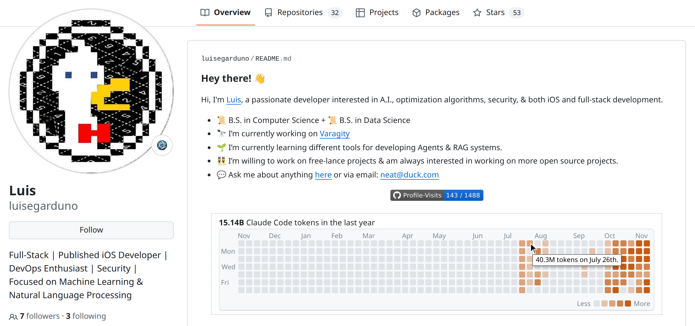

# token-heatmap

Your daily Claude Code token usage as a heatmap on your GitHub profile, laid out like GitHub's contribution graph. Point at a day to see its tokens, such as `96.4M tokens on June 10th.`

<picture>
  <source media="(prefers-color-scheme: dark)" srcset="docs/images/profile-dark.png">
  
</picture>

It's a Claude Code plugin. It reads the usage Claude Code already records on your machine and pushes the daily totals to your own profile repository with your own git login. No server, no account beyond GitHub, no cost.

## Before you start

- **Claude Code** (CLI, desktop app or Agent SDK)
- **Node.js 20+** on the `PATH` Claude Code starts with
- **git** that can push to GitHub without a password prompt: `gh auth login`, then `gh auth setup-git`
- **A profile repository**, `USER/USER`, with a README. Create it on GitHub if you don't have one

macOS and Linux are supported.

## Setup

```sh
claude plugin marketplace add luisegarduno/token-heatmap
claude plugin install token-heatmap@token-heatmap
```

Then, in a new Claude Code session:

```text
/token-heatmap:setup
```

Setup shows what it will publish and asks before changing anything. On yes, it adds the heatmap to the end of your README in one commit by `token-heatmap[bot]`, along with a `token-heatmap/` folder holding your history and the images. After that it updates by itself, at most once an hour while you use Claude Code.

To move the heatmap, move its two marker lines in your README:

```html
<!-- token-heatmap:start -->
<!-- token-heatmap:end -->
```

`/token-heatmap:status` shows the last sync and any error. Setup options: `--no-models` (don't publish model names), `--timezone ZONE` (which time zone decides a day), `--adopt ID` (keep your history after a reinstall).

## How it works

- **Every token counts:** input, output, cache write and cache read. Each API response is counted once, on its day in your time zone.
- **Recorded days stay.** Claude Code deletes old transcripts, but a day in your history is never lowered or removed.
- **Five levels**, scaled to your own usage, so light and heavy users both get a readable graph.
- **Off your contribution graph.** The commits are by `token-heatmap[bot]`, which is linked to no account.
- **Runs only while Claude Code is in use,** so after idle days the last column waits for your next session.

## What leaves your machine

Only these fields, in `token-heatmap/history.jsonl` in your profile repository:

| Field | What it holds |
| --- | --- |
| `date` | The day, YYYY-MM-DD |
| `provider` | `claude-code` |
| `machine` | A random six-character id made at setup |
| `tokens` | The day's four counts, over all models |
| `models` | The four counts per model name. Left out with `--no-models` |
| `input`, `output`, `cache_write`, `cache_read` | The four counts |

A model name is published when it matches `^[A-Za-z0-9._:@-]{1,64}$`. Any other name counts under `other`.

No prompts, code, file paths, project names or transcripts ever leave. [`test/published-fields.test.ts`](test/published-fields.test.ts) fails if anything else does. A profile repository is public, so all of this is public once pushed. See the [privacy policy](PRIVACY.md).

## The history file

`token-heatmap/history.jsonl` is the only store: one line per day, provider and machine. This one is made up:

```json
{"date":"2026-11-12","provider":"claude-code","machine":"k3f9a2","tokens":{"input":1820,"output":412233,"cache_write":1502211,"cache_read":61200412},"models":{"claude-opus-5-5":{"input":1701,"output":371010,"cache_write":1396302,"cache_read":57812400},"claude-sonnet-5-5":{"input":119,"output":41223,"cache_write":105909,"cache_read":3388012}}}
```

Its git history is its backup. To redraw the heatmap from it alone, with only Node.js:

```sh
git clone https://github.com/luisegarduno/token-heatmap
token-heatmap/plugin/bin/token-heatmap render --history history.jsonl
```

## Fixes

Run `/token-heatmap:status` first: it names the last error and its fix.

| Problem | Fix |
| --- | --- |
| `node was not found on PATH` | Install Node.js 20+ where Claude Code can see it. An app started from the dock may not see your shell's `PATH` |
| The push was refused | Run `gh auth setup-git`, or `ssh-add` your key |
| `has the lines of another machine` | After a reinstall, run setup with `--adopt ID` using the id it names |
| Marker lines missing | Put both back where the heatmap should go, or run setup again |
| The profile doesn't change | Syncs run at most once an hour, only while Claude Code is in use |

## Uninstall

```sh
claude plugin uninstall token-heatmap@token-heatmap
claude plugin marketplace remove token-heatmap
```

This stops the hooks and deletes the plugin's local files. To take the heatmap off your profile, delete the marker lines and everything between them, plus the blank line above them, and the `token-heatmap/` folder.

## Contributing

See [CONTRIBUTING.md](CONTRIBUTING.md), [docs/providers.md](docs/providers.md) to add another tool, the [code of conduct](CODE_OF_CONDUCT.md), [SECURITY.md](SECURITY.md) and the [changelog](CHANGELOG.md).

## License

[GPL-3.0](LICENSE).
